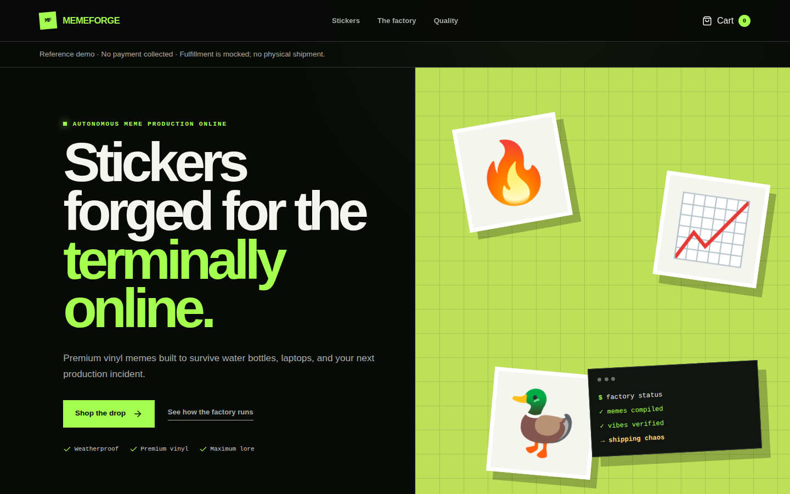
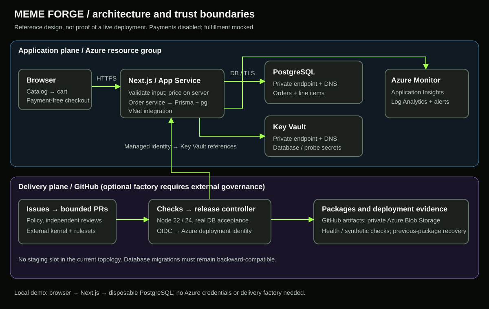

```text
       ___________________________________
      /                                  /|
     /          M E M E  F O R G E       / |
    /__________________________________/  |
    |                                  |  |
    |    [ SHIP IT ]    [ STONKS ]      |  |
    |       .-----------------.        |  |
    |       |  STICKER PRESS  |        | /
    |_______|_________________|________|/
                  ||  ||
               ___||__||___
              /____________\
                 [ MEME ]
```

# Meme Forge

**Azure Commerce and Governed Delivery Accelerator**

A payment-free commerce reference demo for product owners, developers, platform
engineers, and SEs/CSAs exploring Azure modernization and controlled software delivery.

**Readiness: locally verified demo candidate, not catalog-approved or production-ready.**
Licensing, asset rights, accountable maintenance, independent rehearsal, and the
catalog's authoritative schema remain approval gates. See the
[readiness assessment and customer kit](docs/accelerator-guide.mdx).



## Customer story

Digital commerce teams need to test shopping experiences without turning every
experiment into a payment, fulfillment, and infrastructure integration project.
Disconnected prototypes and manual handoffs make it hard to demonstrate a complete
journey or establish confidence in a release. Meme Forge connects product selection
to a PostgreSQL-backed test order and supplies Azure infrastructure and governed
GitHub delivery patterns. It opens a practical conversation about commerce
modernization, operational reliability, and controlled agent-assisted development.

**No payment is collected. Fulfillment is mocked; no physical shipment is created.**
This is not a shopping assistant or runtime AI application.

## Choose your experience

| Experience | Requirements | Useful outcome |
|---|---|---|
| Storefront preview | Node.js and npm | Browse the catalog and use the cart |
| Complete local demo | PostgreSQL and committed migrations | Persist a test order |
| Azure reference deployment | Approved subscription and owner bootstrap | Explore hosting and operations |
| Optional delivery factory | Repository permissions and external governance | Explore bounded agent-assisted delivery |

The local demo needs **no Azure credentials**. Browsing works without a database;
checkout and `/api/health` do not.

## Quickstart

Use **Node 22.13+ or Node 24** and npm. `.node-version` selects Node 22, matching
the Azure App Service runtime. CI validates both majors; the Next.js dependency
is explicitly a canary release, not a stable-only stack.

Run commands from your checkout root:

```bash
npm ci
cp .env.example .env
```

On PowerShell, use `Copy-Item .env.example .env`. Edit `DATABASE_URL` in `.env`
to include your disposable PostgreSQL database's credentials. Keep the database
name ending in `_test` if you will run acceptance tests. The example deliberately
contains no working credentials.

**Use `.env`, not `.env.local`:** Next.js and Prisma CLI both load the root
`.env`; the seed command explicitly loads it too. Next.js gives `.env.local`
and existing shell variables precedence. Remove conflicting local overrides.
Do not commit `.env` or put database credentials in `NEXT_PUBLIC_*` variables.

### Optional disposable PostgreSQL with Docker

Choose a local-only password and export it as `POSTGRES_PASSWORD` in your shell.
Then:

```bash
docker run --name meme-forge-demo \
  -e POSTGRES_USER=meme_demo -e POSTGRES_PASSWORD \
  -e POSTGRES_DB=meme_forge_test \
  -p 127.0.0.1:5432:5432 -d postgres:16
```

Wait for `docker exec meme-forge-demo pg_isready -U meme_demo -d meme_forge_test`.
Configure `.env` with this user's connection URL, then:

```bash
npm run db:migrate
npm run db:seed
npm run dev
```

Open <http://localhost:3000>. `db:migrate` applies the **committed migrations**;
do not create a new migration just to run the demo. `db:seed` checks connectivity:
the six sample products are defined in `src/domain/catalog.ts`, not database rows.

## Run the reference journey

1. Agree the customer hypothesis: demonstrate commerce without connecting payments.
2. Browse the version-controlled catalog for product and price context.
3. Add one **Ship It** and one **Senior Duck Engineer**; subtotal **$9.98**.
4. Change a quantity and restore one of each.
5. Select **Create test order**. The server validates identifiers and quantities,
   resolves prices itself, and persists the order and its items together.
6. Reach the confirmation page. It is generic and does **not** verify an order:
   independently check persistence with the read-only query in the presenter guide.
7. Verify `/api/health` and discuss deployment evidence.
8. Agree one customer-specific integration and a bounded pilot.

The expected stored total is **998 cents**, mode `PAYMENT_FREE`, status
`FULFILLMENT_PENDING`, and two line items. No customer email is requested.

## Architecture



The application uses Next.js, TypeScript, Prisma's PostgreSQL adapter, and PostgreSQL.
Azure Bicep defines App Service, private endpoints/DNS for PostgreSQL, Key Vault
and Blob Storage, managed identity, Log Analytics, Application Insights, and alerts.
GitHub OIDC supplies the deployment identity; the optional factory is a separate
control plane, not a requirement for local checkout.

## Validate and reproduce evidence

```bash
npm run check
npm run test:coverage
npm audit --omit=dev --audit-level=high
```

`check` runs lint, type checking, Vitest, and the production build. System fonts
avoid Google Fonts downloads at build time. The lockfile retains exact versions
and integrity hashes without environment-specific registry URLs.

For real persistence tests, export `DATABASE_URL` and set `TEST_DATABASE_URL` to
the **same disposable database**, apply migrations, then run:

```bash
npm run db:migrate
npx vitest run tests/database.integration.test.ts
```

Vitest does not automatically load `.env`; export these variables in the shell.
Without `TEST_DATABASE_URL`, the four database tests are explicitly skipped.
The suite refuses database names not ending in `_test` and cleans up only its
own created orders. The suffix is a safety check, not a substitute for choosing
a disposable database. Never point these tests at customer or production data.

CI provisions PostgreSQL 16 and runs acceptance on Node 22 and 24. The aggregate
`Validate` check preserves the existing branch-protection context; `Analyze`
remains the CodeQL check. See [captured evidence](docs/assets/evidence.json) for
the tested source revision and local runtime, not an assertion that remote CI passed.

## Demo and customer engagement

- [Five- and fifteen-minute scripts, discovery, pilot, and acceptance scorecard](docs/accelerator-guide.mdx)
- [Captioned five-minute recording viewer](docs/assets/walkthrough.html)
- [Video](docs/assets/walkthrough.webm) · [captions/transcript](docs/assets/walkthrough.vtt)
- [Mobile](docs/assets/storefront-mobile.png) · [cart](docs/assets/cart.png)
- [Confirmation](docs/assets/checkout.png) · [sanitized persistence evidence](docs/assets/persistence.png)

To play captions, serve the assets over HTTP as described in the viewer. Captures
use synthetic data in local PostgreSQL, not a customer or Azure production environment.

## Deployment, recovery, and teardown

Read the [deployment and adaptation guide](docs/accelerator-guide.mdx) and
[existing Azure owner bootstrap](docs/factory-bootstrap.md) before provisioning.
Cloud setup changes permissions and creates billable resources; obtain explicit
approval before running it.

The documented Azure topology deploys directly to production without a staging slot.
Application recovery redeploys the previous package, **not the previous database**.
Migrations must remain compatible with the previous application. The documented
$75 monthly budget is an alert threshold, not a price estimate or spending cap.

For the disposable Docker database only, `docker rm -f meme-forge-demo` removes
the container and its demo data. Review volume retention separately if you add
persistent mounts. Cloud teardown requires owner review of retained data,
resource-group scope, identities, budgets, federation, and workflow schedules.

## Factory and reuse boundaries

GitHub Issues are the durable work queue. Agentic Workflows use bounded issues,
read-only agent jobs, and SafeOutputs; deterministic Actions enforce checks,
provenance, review attestations, deployment, monitoring, and recovery.
`.factory/policy.yml` defines WIP, retry, diff, risk, and rollout limits.

The factory depends on an **external organization-level required workflow** in
the dark-factory kernel and repository rulesets. Copying this repository alone
does not recreate that enforcement. Do not enable unattended operation in a fork
until equivalent controls are independently established.
See [bootstrap](docs/factory-bootstrap.md) and [signal collector](docs/factory-signals.md).

## Security, support, and license

Use synthetic data only. Public checkout has no implemented customer identity,
payment, inventory, or fulfillment integration; assess abuse controls and log
redaction before exposing a pilot. See the guide's security and support sections.

Use [repository issues](https://github.com/The-weyland-yutani-corporation/meme-sticker-e-commerce-store/issues)
for non-sensitive questions. No response SLA is offered. Maintainer assignment,
a private vulnerability-reporting channel, redistribution license, and asset-rights
approval remain owner decisions; do not publish vulnerabilities in public issues.
**No redistribution license is granted by this readiness package.**

`accelerator.yaml` is a clearly marked draft. The catalog redirects to enterprise
SSO and its schema could not be verified; obtain the authoritative schema and
contribution guide before submitting.

## Start a customer conversation

Bring a product owner, platform lead, and integration engineer. Choose one journey,
identify integration and governance constraints, and agree a pilot owner and
measurable acceptance criteria before connecting real systems.
